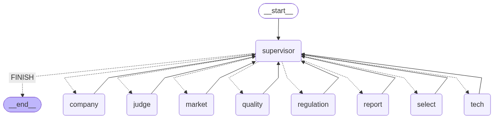

# AI Startup Investment Evaluation Agent — Multi-Agent Orchestration
6조 : 김윤성, 정문기, 이승호, 이세영, 이준영

AI 신약개발(Healthcare AI) 스타트업 4곳의 공개 근거를 모아 투자 위험을 평가하는 에이전트를 **Supervisor 패턴**으로 다시 설계했다. RAG 과제 버전(main 브랜치)의 조사 · 판정 모듈을 재사용하고, 흐름 제어 · State · 보고서 · 품질 평가를 바꿨다.

## Overview

- **Objective** : 후보 4곳을 기업 · 기술 · 규제 · 시장 관점의 웹 원문 근거로 평가해 12개 위험요인 점수와 판정(적격 · 보류 · 부적격)을 내고, 통합 보고서 1부(최대 10쪽)를 만든다.
- **Pattern** : **Supervisor** — RAG 버전은 4곳 × 12항목 = 48칸 중 45칸이 근거 부족(찾지 못함 26, 기업 주장만 19)으로 끝나 4곳 모두 보류였다. 영역마다 고정 검색어로 한 번만 조사하고 근거가 충분한지 확인하는 단계가 없었기 때문이다. 조사 결과를 보고 **부족한 영역만 다시 조사시키는 제어**가 필요해 Supervisor를 골랐다. Orchestrator-Workers는 조사 전에 계획을 세우는 구조라, 무엇이 부족할지는 조사해 봐야 아는 이 문제에는 맞지 않았다. 순차 실행이라 느려지는 대신 재작업 예산으로 비용을 묶었다.
- **동적 처리** : RAG 버전은 `select → (company ∥ tech) → (regulation ∥ market) → judge` 순서가 엣지로 고정돼 있었다. 이번 버전은 엣지가 `supervisor ⇄ 워커`뿐이고, supervisor가 매 턴 State(영역별 조사 상태, 관문 · 영역별 "확인됨" 근거 수, 재작업 횟수)를 보고 다음 담당을 정한다. 그래서
  - 기업마다 조사 순서, **재작업 대상 · 횟수**가 근거 상태에 따라 달라질 수 있다 (4개 영역 첫 조사를 마친 뒤 근거가 충분하면 재작업 없이 판정, 부족하면 관문이 걸린 영역부터 다시 조사). 제출 실행에서는 4곳의 근거 상태가 비슷해 같은 순서가 나왔다(아래 실행 결과)
  - 재작업 때는 supervisor가 부족한 항목과 새 검색어를 지시한다
  - 보고서가 품질 평가를 통과하지 못하면 지적된 문장만 고쳐 다시 평가한다

## Goal · Success Criteria

- **Desired Outcome** : 투자심의 담당자가 후보 4곳 각각에 대해 "어떤 근거로 적격 · 보류 · 부적격인지, 보류라면 무엇을 확인하면 다시 볼 수 있는지"를 보고서 1부로 바로 판단한다. 기업가치 산정 · 투자 실행 권고는 범위 밖이다.
- **Success Criteria** (코드로 검사하는 것만 적었다)

| 구분 | 기준 | 검사 위치 |
|---|---|---|
| 결과 품질 | 사실 문장의 인용 번호 → 참고문헌 → 근거 ID 연결 100%, 사실 문장의 수치(금액 · 날짜 · 비율 · 물질 번호)가 인용 원문에 그대로 있음, 인용 원문으로 뒷받침되는지 LLM Judge 통과, 사실 문장의 투자 권유 · 우열 · 과장 표현 0건 (코드가 만든 판정 문장은 중립성 의견만 기록). 인용은 300자까지만 저장하므로 그 밖의 내용은 근거로 치지 않는다 | `quality/evaluator.py` |
| 결과 품질 | 관문 2항목 · 4영역 "확인됨" 근거 여부를 판정 전에 확인, 부족하면 재작업 | `agents/supervisor.py` |
| 업무 제약 | 보고서 10쪽 이하, SUMMARY(개요 문장 없음) · REFERENCE 필수 | `quality/evaluator.py`, `report/pdf.py` |
| 운영 | 기업당 재작업 2회 · 보고서 재작성 2회, 조사 단계 워커 호출 60회(넘으면 조사를 멈추고 마무리), 마무리까지 포함한 절대 상한 74회(후보 4곳 기준), 무한 루프 없이 종료 | `agents/supervisor.py`, `tests/test_graph.py` |
| 운영 | 조사 워커 · 판정 LLM이 실패해도 그래프가 멈추지 않고 에러를 남김 | `agents/common.py run_area`, `judge/node.py` |

## Features

- **근거 수집** : 웹 검색 → 원문 페이지 → LLM 추출 → 인용문이 원문에 실제로 있는지 코드로 검증. 목표 기업명(국문 · 영문)이 없는 원문은 조사 예산에서 뺀다(다른 회사 기사가 섞이는 것을 실측으로 확인해 추가). 임상 등록 · 논문은 영문 자료가 많아 기술 · 규제 조사와 재작업에 영문명 검색어를 쓴다. 규제 · 기술 · 시장 기준 문서는 Agentic RAG로 찾아 추출 문맥으로만 쓴다.
- **근거 충분성 루프** : 관문 2항목(기술, 법률·정책)과 4영역마다 독립 출처로 "확인됨"인 근거가 있는지 코드가 계산한다. 부족하면 판정으로 넘어가지 않고 재작업한다(기업당 2회, 영역당 1회). 재작업 때는 부족한 항목만 추출 대상으로 좁히고, 같은 영역이 이미 읽은 원문은 다시 열지 않는다(다른 영역이 읽은 원문은 자기 관점으로 다시 분석). 재작업 검색어는 공식 · 학술 출처(논문 DB, ClinicalTrials.gov, 식약처 · FDA, 공시)로 먼저 좁혀 찾는다(`config.SOURCE_DOMAINS`). 결정 로그에 재작업 전후 근거 · 확인됨 수를 남겨 재작업이 실제로 근거를 늘렸는지 확인한다.
- **확증 편향 방지 전략**
  - 충분성 기준은 "긍정 근거"가 아니라 "독립 출처로 확인된 근거"다. 부정 사실도 확인되면 충분하다.
  - 재작업 검색어 중 하나는 위험 방향(중단 · 반려 · 지연 · 소송 · 해지)이다. LLM이 빠뜨리면 코드가 추가한다.
  - "확인됨"은 LLM 추측이 아니라 **출처 유형**으로 정한다. 기업 자체 사이트(도메인에 기업 영문명 · ID)는 LLM이 확인됨으로 분류해도 "기업 주장만", 공식 기록 · 동료심사 논문(ClinicalTrials.gov, PubMed · PMC · Nature, FDA · `.go.kr`, DART)은 "확인됨", 그 밖의 언론은 LLM 분류를 따른다(`config.INDEPENDENT_DOMAINS`). 회사 홈페이지 기술 소개가 "확인됨"으로 잡혀 기술 관문을 통과시킬 뻔한 일, 반대로 논문 · 임상 등록 원문이 "기업 주장만"으로 분류되는 일을 실행 중 보고 넣었다. 보고서에서는 기업 주장만인 근거를 끝의 상태 표기로 구분한다.
  - 보고서는 기업마다 인용 출처를 서로 다른 사이트에서 고르고, 한 사이트에만 의존하면 한계점에 공개한다. 미확인 · 부정 항목은 한계점에서 빠지지 않는다.
- **보고서 품질 평가** : 보고서를 만든 뒤 품질 평가 노드가 Groundedness · 중립성 · 편향 통제 · 형식을 평가하고, 미달이면 지적된 문장만 재작성해 다시 평가한다(최대 2회). 근거성 위반 문장은 근거 원문 인용으로 바꾸고, 중립성 위반 문장은 LLM이 중립 표현으로 다시 쓴다. 판마다 PDF 사본(`<trace_id>_report_v0.pdf`, `_v1.pdf` …)을 남겨 무엇이 고쳐졌는지 비교할 수 있다. 편향 · 형식은 문장 하나를 고쳐서 풀리는 문제가 아니라 보고서를 만들 때 규칙으로 막는다(출처 편중 · 미확인 항목을 한계점에 자동 공개, 10쪽 상한). 그래도 미달이면 재작성 상한 뒤 `status=quality_failed`로 끝내고 남은 지적을 실행 로그에 남긴다. 평가 방식은 규칙 + LLM Judge **Hybrid**이고, 통과 여부는 코드가 정한다. 재평가 때 바뀌지 않은 문장은 직전 판의 LLM 판정을 다시 쓰고, 고친 문장만 새로 묻는다(규칙은 매 판 전부 다시 검사).

| 평가 항목 | 규칙(결정론) | LLM Judge (gpt-4.1) |
|---|---|---|
| Groundedness | 사실 문장마다 인용 번호 · 근거 ID 존재, [n] ↔ REFERENCE 대응, 안 쓰인 참고문헌 없음, 문장의 수치가 인용 원문에 있음 | 문장이 인용한 원문으로 뒷받침되는가 (원문을 그대로 옮긴 줄은 판정하지 않음) |
| 중립성 | 과장 수식어 사전(최고 · 최초 · 획기적 · 압도적 · 독보적 · 혁신적 · 극대화 등), 기업 주장만인 근거를 쓴 문장의 귀속 표시("(기업 주장만" 표기 · "밝혔다") | 투자 권유 · 기업 간 우열 · 전망 · 문맥상 과장 |
| 편향 통제 | 기업별 인용 출처가 한 곳뿐이면 한계점에 공개, 음수 · 관문 미충족 항목 누락 없음, 기업 주장만 인용 공개 | — |
| 형식 | 10쪽 이하, SUMMARY · REFERENCE 존재, SUMMARY에 개요 문장 없음 | — |

## Tech Stack

- **Framework** : LangGraph 1.0 (StateGraph, add_conditional_edges, SQLite checkpointer), LangChain
- **LLM/Supervisor** : gpt-4.1-mini (구조화 출력 — 다음 담당 · 사유 · 재작업 검색어)
- **LLM/Generator** : gpt-4.1-mini (원문 추출, 보고서 판단 요지 · 중립 재작성)
- **LLM/Judge** : gpt-4.1-mini (12항목 예/아니오 → 점수는 코드), gpt-4.1 (보고서 품질 평가 — 생성 모델과 분리)
- **Retrieval** : FAISS — Hit Rate@3 **0.824**, MRR **0.703** (평가셋 34문항, 상세는 main 브랜치 README)
- **Embedding** : `BAAI/bge-m3`
- **Web** : Tavily 검색(재작업은 `include_domains`로 공식 · 학술 출처 우선) + 원문 HTML/PDF 수집
- **Tracing** : LangSmith (`metadata.trace_id`)
- **Test** : pytest (LLM · 네트워크 없이 그래프 흐름 · 재작업 · 종료 · 품질 루프 · 보고서 재생성 검증)
- **Runtime** : Python 3.11, 패키지 버전은 `requirements.txt`에 고정(테스트 · 제출 실행에 쓴 버전)

## Agents

| 이름 | 노드 | 하는 일 |
|---|---|---|
| Supervisor | `supervisor` | 근거 충분성 계산 → 허용 행동 계산 → LLM이 다음 담당 · 사유 · 재작업 검색어 선택 → 허용 밖이면 코드가 교정. 결정마다 로그 |
| 후보 선택 | `select` | 다음 기업 선택, 기업 단위 상태(영역 상태 · 재작업 횟수 · 읽은 URL) 초기화 |
| 기업 조사 | `company` | 경영진 · 자금 조달 · 평판 |
| 기술·파이프라인 | `tech` | 기술(관문) · 사업 단계 · 제조, 물질 · 적응증 · 단계 목록 |
| 규제 | `regulation` | 법률·정책(관문) · 소송 · 해외 — supervisor가 넘겨준 물질 목록 단위로 조사 |
| 시장·사업화 | `market` | 영업·마케팅 · 경쟁 · 투자금 회수 — 물질 · 적응증 단위 |
| 투자 판단 | `judge` | LLM은 항목별 예/아니오와 근거 ID만, 점수 · 관문 · 판정은 코드 |
| 보고서 작성 | `report` | 4곳 통합 보고서(SUMMARY · 1~5장 · REFERENCE, 10쪽 이하). 재작성 때는 지적 문장만 수정 |
| 품질 평가 | `quality` | Hybrid 평가, 통과 여부는 코드 |

워커는 다른 워커를 부르거나 다음 담당을 정하지 않는다. 기술 워커가 찾은 물질 목록도 supervisor가 받아 규제 · 시장 워커의 지시(`task.pipeline`)에 실어 보낸다. 무엇을 · 언제 할지(WHAT · WHEN)는 supervisor가 정하고, 어떻게 찾을지(HOW: 검색 → 원문 → 추출 → 인용 검증)는 워커가 정해진 절차로 수행한다.

**액터** : 투자심의 담당자(실행 · 보고서 수신) / supervisor와 8개 워커 / 외부 서비스 — Tavily(검색), 원문 웹사이트, OpenAI(LLM), LangSmith(트레이스)

### 어디까지가 LLM 판단인가

| LLM이 정하는 것 | 코드가 정하는 것 |
|---|---|
| 허용된 행동 중 다음 담당, 그 사유 | 근거 충분성(관문 · 영역 확인됨 수), 허용 행동 목록, 데이터 의존(규제 · 시장은 기술 다음) |
| 재작업 대상 항목과 새 검색어 | 재작업 · 재작성 · 단계 상한, 허용 밖 선택 교정 |
| 원문에서 사실 · 인용 추출, 상태(확인됨/기업 주장만) 1차 분류 | 인용문이 원문에 있는지, 기업 자체 사이트면 기업 주장만으로 교정, 목표 기업명 없는 원문 제외 |
| 12항목 예/아니오와 근거 ID | 점수 변환 · 합계 · 관문 · 판정 · 민감도 |
| 보고서 기업별 판단 요지, 지적 문장 재작성 | 보고서 구조 · 대표 근거 선택 · 인용 번호 · 10쪽 상한 |
| 문장별 근거성 · 중립성 판정 | 품질 통과 여부, 편향 · 형식 규칙 |

## State Schema

```python
class State(TypedDict, total=False):
    # 작업 페이로드
    candidates, company, pipeline
    evidence: Annotated[list[Evidence], merge_evidence]      # 같은 (기업, 출처, 인용)은 한 번만
    scores, total, verdict                                    # 현재 기업 판정
    evaluations: Annotated[list[dict], merge_by_company]      # 기업당 1건, 다시 판정하면 교체
    scores_by_company: Annotated[dict, merge_dict]
    report_sections, report_path, report_pages, quality
    # 제어 메타
    trace_id, next, task, current_idx
    area_status, rework_count, read_urls
    step_count: Annotated[int, operator.add]
    max_steps, report_revisions, status
    errors: Annotated[list[dict], operator.add]
    last_error
```

- **제어 vs 페이로드 분리** : 라우팅에 필요한 최소치(`next` · `task` · `area_status` · `rework_count` · `step_count` · `report_revisions` · `status`)만 제어 영역에 두고, 조사 · 판정 · 보고 결과는 페이로드 영역에 둔다. supervisor는 페이로드에서 근거 상태 집계, 파이프라인(규제 · 시장 지시에 실어 보냄), 보고서 판 번호 · 품질 결과만 읽는다. 워커는 `add_node(input_schema=...)`로 자기 입력 키만 받는다(`state.py` 하단 `TechInput` · `ResearchInput` · `JudgeInput` · `ReportInput` · `QualityInput`) — State 전체를 공유하지 않는다.
- **관측성 위치** : 결정 로그(다음 담당 · 사유 · 허용 행동 · 부족 근거 · 검색어 · LLM 사용 · 교정 여부)는 State가 아니라 `outputs/logs/<trace_id>.jsonl`에 쌓는다. State에는 마지막 지시(`task.reason`)만 덮어써서 LangSmith 노드 출력에서 "왜"가 보이게 했다.
- **지속성 비용** : 원문 페이지 · RAG 청크는 워커 안에서만 쓰고 State에 넣지 않는다. 근거는 인용 300자 제한에 워커당 원문 수 상한(기본 8, 실행 옵션 `--pages-per-node`)과 재작업 예산으로 개수가 묶인다. PDF는 파일로 두고 경로만 남긴다. 품질 평가가 읽어야 하는 문장 구조 `report_sections`는 State에 두지만 덮어쓰기라 실행 중 한 벌(보고서 1부 분량)만 있다. 결정 로그는 State 밖(jsonl)에 쌓는다.
- **상관** : `trace_id` 하나로 LangGraph `thread_id`(체크포인트), LangSmith `metadata.trace_id`, 결정 로그 · 실행 로그 파일명, 보고서 파일명을 잇는다.
- **재개/복구** : SQLite 체크포인터에 매 단계가 저장되고, 재개에 필요한 상태(`current_idx` · `area_status` · `rework_count` · 영역별 `read_urls`)가 State에 있다. `python app.py --resume <trace_id>`로 마지막 체크포인트부터 이어 간다(`tests/test_graph.py::test_resume_from_checkpoint_after_crash` — 워커 예외로 멈춘 뒤 이어 실행하면 끝난 조사는 반복하지 않고 끝까지 간다). 끝난 실행의 보고서만 다시 만들 때는 `--rebuild-report <trace_id>`가 체크포인트를 판정 직후 상태로 되돌린다(`app.reset_report_stage`, `test_rebuild_report_reruns_only_report_stage` — 조사 · 판정은 반복하지 않음). 조사 워커가 실패하면 예외로 멈추지 않고 `area_status=failed`를 남기고, supervisor는 그 상태로 재시도 여부를 정한다. `errors` · `last_error`(노드 · 유형 · 메시지 · 시각)는 원인 추적용 기록이다.
- **동시 처리** : supervisor는 한 번에 워커 하나만 부르므로 같은 키에 동시에 쓰는 일이 없다. 그래서 동시성용 리듀서는 필요 없고, 누적 키에만 리듀서를 둔다. 재작업 · 재개로 같은 근거나 같은 기업 판정이 다시 들어와도 중복되지 않도록 `merge_evidence` · `merge_by_company`를 썼다.
- **종료 보장** : 재작업은 기업당 2회 · 영역당 1회, 보고서 재작성은 2회까지다. 워커 호출 수가 `max_steps`(60)에 닿으면 조사를 멈추고 남은 필수 단계(판정 → 보고서 → 품질 평가)로 간다. 그 위에 마지막 상한과 LangGraph `recursion_limit`을 둔다.

## Architecture



- 실선 = 워커 → supervisor 복귀, 점선 = supervisor의 조건부 분기(`add_conditional_edges(route=state["next"])`)
- supervisor의 판단 순서: 단계 상한 → 4곳 판정 완료면 보고서 · 품질 평가 → 현재 기업이 없으면 후보 선택 → 미조사 영역(규제 · 시장은 기술 다음) → 근거 부족이고 예산이 남았으면 재작업 → 그 밖에는 판정

## 실행 결과 (`trace_id 1013-1324-d16d`, 커밋 `3687430(조사 · 판정) + cb2e65c(보고서 단계, --rebuild-report)`)

`python app.py --pages-per-node 4 --urls-per-query 2`로 4곳을 실행했다. 기록은 [`docs/run-1013-1324-d16d/`](docs/run-1013-1324-d16d/) — 결정 로그 `decisions.jsonl`, 실행 로그 `run.json`(근거 · 판정 · 품질 결과 · 수정 전후 문장), 판별 보고서 `report_v*.pdf`.

| 기업 | supervisor가 정한 순서 | 재작업 효과 (기업 전체 확인됨 근거 수 전 → 후 / 기업 전체 근거 수 전 → 후) | 판정 |
|---|---|---|---|
| 스탠다임 | 기술 → 규제 → 기업 → 시장 → 규제(재) → 기술(재) | 규제 1→1 / 21→21; 기술 1→1 / 21→26 | 보류 +9점 |
| 디어젠 | 기술 → 규제 → 기업 → 시장 → 규제(재) → 기술(재) | 규제 1→1 / 25→26; 기술 1→3 / 26→33 | 보류 +11점 |
| 갤럭스 | 기술 → 규제 → 기업 → 시장 → 규제(재) → 기술(재) | 규제 2→2 / 16→18; 기술 2→2 / 18→23 | 보류 +9점 |
| 닥터노아바이오텍 | 기술 → 규제 → 기업 → 시장 → 규제(재) → 기술(재) | 규제 0→0 / 19→19; 기술 0→0 / 19→21 | 보류 +5점 |

- 조사 · 판정 구간: supervisor 결정 32회 중 LLM이 고른 것 20회, 가드가 교정한 것 0회. 워커 호출은 이 구간 32회 + 마지막 보고서 구간 4회 = 36회.
- 재작업 8회 중 확인됨 근거를 늘린 재작업 1회. 재작업은 근거를 더 모았지만(전체 근거 수 증가) 독립 출처 확인으로 이어진 경우는 적었다 — 비상장사는 공시 · 논문 · 규제 기관 기록 자체가 적다.
- 마무리(마지막 보고서 단계): report(모든 후보 판정 완료) → quality(새 보고서는 품질 평가부터) → report(품질 미달(근거성 9건 · 중립성 15건 미달) — 재작성) → quality(새 보고서는 품질 평가부터) → FINISH(품질 평가 통과) — 앞선 보고서 단계 8회의 결정도 `decisions.jsonl`에 남아 있다.
- 최종 상태 `done`, 보고서 6쪽, 재작성 1회, 품질: 4개 항목 모두 통과

품질 평가가 고친 문장 예 (전 → 후):

- v1 `ch2-010` [groundedness] 기사에 매출·시장 규모 정보가 없다는 사실은 quote에서 확인할 수 없다. quote는 ALS 치료제 후보의 평가 결과만 언급한다.
  - 전: 닥터노아바이오텍 · 영업·마케팅: 해당 기사에는 닥터노아바이오텍의 매출이나 시장 규모에 관한 정보가 없다. (기업 주장만, 2025-12-26 자료) [13]
  - 후: 닥터노아바이오텍 · 영업·마케팅: 원문 — "이번 분석에서는 ALS(루게릭병, 근위축성측삭경화증) 치료제 후보로 개발 중인 닥터노아바이오텍의 NDC-011이 다수의 평가 지표에서 높은 수준을 보이며 주목할 만한 결과를 기록했다." (기업 주장만, 2025-12-26 자
- v1 `ch1-idea-galux` [neutrality] 과장 수식어 세계적 사용
  - 전: 갤럭스 · 사업 아이디어: 갤럭스는 세계적 수준의 항체 설계 AI 플랫폼 'GaluxDesign'을 개발했으며, 이 플랫폼은 구글 딥마인드의 AlphaFold와 워싱턴 대학교의 RosettaFold와 동등한 성능을 보인다. (기업 주장만, 2024-08-26 자료) [
  - 후: 갤럭스 · 사업 아이디어: 갤럭스는 항체 설계 AI 플랫폼 'GaluxDesign'을 개발했으며, 이 플랫폼은 구글 딥마인드의 AlphaFold와 워싱턴 대학교의 RosettaFold와 동등한 성능을 보인다고 밝혔다. (기업 주장만, 2024-08-26 자료) [7]
- v1 `ch1-007` [neutrality] 과장 수식어 최상 사용
  - 전: 갤럭스 · 경영진: 갤럭스의 석차옥 대표는 단백질 신약설계 기술 분야에서 최상위 수준의 기술력을 보유하고 있다. (기업 주장만) [8]
  - 후: 갤럭스 · 경영진: 갤럭스의 석차옥 대표는 단백질 신약설계 기술 분야에서 기술력을 보유하고 있다고 밝혔다. (기업 주장만) [8]

- 조사 · 판정은 커밋 `3687430`으로 한 번 실행했다. 보고서 · 품질 평가 단계는 그 뒤 보고서 쪽 코드를 고칠 때마다 같은 실행의 체크포인트에서 다시 만들었다(조사 · 판정 결과는 그대로): 필수 내용 보완(`97f927b`) → 최종본 결함 3건 수정(`eba4159`) → 요구사항 검토 반영(`ba0fc90`~`cb2e65c`: 수치 근거 규칙, 경영진 · 사업 아이디어 · 시장 규모 근거 선택, 바뀌지 않은 문장의 LLM 판정 재사용, 원문 인용 줄의 LLM 판정 제외). 지금은 `python app.py --rebuild-report 1013-1324-d16d` 한 줄로 같은 절차를 재현한다. 앞선 보고서 단계의 결정도 결정 로그에 이어서 남아 있다.
- 4곳 모두 관문 근거가 0~2건인 비슷한 상태라 supervisor가 같은 순서(관문 영역 먼저)를 골랐다. 경로는 순서표가 아니라 State로 정해진다 — 근거가 충분하면 재작업 없이 판정, 실패한 영역만 재시도, 예산 소진 시 판정으로 가는 경우는 `tests/test_graph.py`가 각각 다른 경로로 검증한다.

## Directory Structure

```
├── agents/
│   ├── supervisor.py          # 충분성 · 허용 행동 · LLM 선택 · 가드 · 결정 로그
│   ├── common.py              # 조사 공통: 검색 · 원문 검증 · 재작업 지시 반영 · 실패 처리
│   ├── select_candidate.py
│   ├── company.py · tech_pipeline.py · regulation.py · market.py
├── judge/                     # 12항목 LLM 예/아니오 → 코드 점수 · 판정
├── report/                    # 통합 보고서 문장 구조 · 재작성 · PDF · REFERENCE
├── quality/evaluator.py       # 품질 평가 (Hybrid)
├── prompts/                   # supervisor · judge · 조사 · 보고서 · 품질 프롬프트
├── rag/ · data/               # Agentic RAG와 문서 풀 (main 브랜치와 동일)
├── tools/                     # 웹 검색 · 원문 수집, Evidence 타입
├── outputs/                   # 보고서 PDF, logs/(결정 · 실행 로그)
├── docs/                     # graph.png, run-<trace_id>/(제출 실행 기록: 결정 로그 · 실행 로그 · 판별 보고서)
├── tests/
├── config.py · state.py · graph.py · app.py
└── README.md
```

## Usage

```bash
python -m venv .venv && source .venv/bin/activate
pip install -r requirements.txt
```

`.env`에 키를 넣는다.

```
OPENAI_API_KEY=...
TAVILY_API_KEY=...
LANGSMITH_API_KEY=...        # 트레이스를 볼 때
LANGSMITH_TRACING=true
```

```bash
python app.py                                        # 전체 실행 (워커당 원문 8쪽 · 검색어당 3개, 약 20분)
python app.py --pages-per-node 4 --urls-per-query 2  # 제출한 실행 결과의 설정 (약 10분)
python app.py --resume <trace_id>                    # 중단된 실행 이어서
python app.py --rebuild-report <trace_id>            # 끝난 실행의 보고서 · 품질 평가 단계만 다시 (조사 · 판정 결과는 그대로)
pytest                                               # LLM 없이 흐름 검증
```

실행하면 `trace_id`, supervisor의 결정과 사유, 기업별 판정, 품질 평가 결과가 한 줄씩 출력되고 `outputs/<trace_id>_report.pdf`, `outputs/logs/<trace_id>.json(l)`이 생긴다.

## 운영 기준

- **호출 상한(비용)** : 기업당 LLM 호출 ≈ supervisor 선택(허용 행동이 2개 이상이거나 재작업일 때만, 최대 6회) + 원문 추출(조사 4회 + 재작업 2회) × 워커당 원문 상한 + RAG(3영역, 질문 생성 · 관련성 채점 · 재작성 최대 1회) + 판정 1회. 보고서는 기업별 판단 요지 4회 + 재작성 1회당 1회, 품질 평가는 판마다 1회(문장이 많으면 기업 단위로 나눔). 워커당 원문 상한은 `--pages-per-node`(기본 8)로 조절한다.
- **타임아웃 · 동시성** : 원문 수집은 연결 5초 · 읽기 20초 제한, 실패하면 다음 검색 결과로 넘어간다. 한 워커 안의 LLM 추출만 4개까지 동시에 돌리고(`AGENT_EXTRACT_WORKERS`), 워커 자체는 supervisor가 한 번에 하나씩 부른다.
- **폴백** : supervisor LLM 실패 → 코드 기본 선택 / 조사 실패 → `area_status=failed` 후 재시도 여부를 supervisor가 결정 / 판정 LLM 실패 → 12항목 "찾지 못함"으로 보류 / 품질 Judge 실패 → 해당 항목 미달 / 10쪽 초과 → 그래프를 멈추지 않고 형식 미달로 기록(문장 수정으로는 줄지 않으므로 재작성 상한 뒤 `quality_failed`) / 재작성 상한 도달 → `status=quality_failed`로 종료하고 실행 로그에 남은 지적을 기록.
- **시각 기록** : 결정 로그 · 에러는 ISO 8601 초 단위(`2026-10-13T12:13:05+09:00`), 근거는 원문 발행일 · 열람일(일 단위).
- **Middleware를 쓰지 않은 이유** : LangChain 1.0 Middleware는 `create_agent` 루프에 정책을 거는 장치다. 이 그래프는 노드를 직접 조립했기 때문에 같은 역할(호출 상한 · 재시도 · 폴백)을 supervisor의 허용 행동 · 상한과 각 노드의 예외 처리로 구현했다.

## 의사결정 기록

| 바꾼 판단 | 이유 |
|---|---|
| Orchestrator-Workers 대신 Supervisor | 문제는 병렬 속도가 아니라 근거 부족이었고, 무엇이 부족한지는 조사해 봐야 안다 |
| supervisor 선택을 "LLM 단독"이 아니라 "코드가 허용 행동을 거르고 LLM이 고름"으로 | 근거 충분성 · 상한 · 데이터 의존은 결정론으로 지켜야 재현 · 종료가 보장된다. LLM이 허용 밖을 고르면 코드가 교정 |
| 재작업 예산을 영역당 1회 → 기업당 2회(관문 2개)로 | 처음엔 부족한 영역을 전부 재작업해 기업마다 똑같이 4회가 돌았다. 예산을 줄여 supervisor가 어디에 쓸지 고르게 했다 |
| 재작업 검색어만 바꾸기 → 공식 · 학술 출처 도메인 지정 검색 추가 | 첫 실행에서 재작업 8회 중 확인됨 근거를 늘린 것이 1회뿐이었다. "확인됨"은 독립 출처라 출처 유형을 지정하는 게 지렛대였다 |
| 기술 워커의 물질 목록을 State로 공유 → supervisor 지시(`task.pipeline`)로 전달, 워커별 입력 범위(`input_schema`) | 워커끼리 State를 직접 주고받는 경로를 없애 "Supervisor와만 통신"을 코드로 보장 |
| 목표 기업명 확인 · 확인됨을 출처 유형으로 정의(자체 사이트 = 기업 주장만, 공식 기록 · 논문 = 확인됨) | 실행 중 다른 회사 기사(디어젠 조사에 테슬라 기사), 회사 홈페이지가 "확인됨", 논문 원문이 "기업 주장만"으로 들어오는 것을 확인. LLM 분류에 맡기면 같은 출처도 실행마다 달라졌다 |
| 결정론 보고서 → 기업별 판단 요지만 LLM이 쓰고 나머지는 코드 | 품질 평가가 실제로 고칠 문장이 있어야 루프가 의미 있다. 판정 · 점수 문장은 코드가 써서 바뀌지 않게 |
| 귀속 판정을 LLM Judge에서 코드 규칙으로 | 같은 "(기업 주장만)" 표기를 Judge가 실행마다 다르게 읽었다(한 실행은 0건, 다른 실행은 33건 지적). 문자열로 확인되는 것은 코드가, 문맥이 필요한 것(권유 · 우열 · 전망)만 LLM이 본다 |
| 수치 근거 규칙 추가 | 인용은 300자까지만 저장하는데, 잘린 뒤쪽에만 있던 수치("IC50 <1 µM")를 쓴 문장이 LLM Judge를 통과했다(요구사항 검토에서 발견). 수치는 문자열로 확인되므로 규칙으로 옮겼다 |
| 바뀌지 않은 문장은 직전 LLM 판정 재사용 | 보고서를 다시 만들 때, 앞 판에서 통과한 같은 문장을 LLM Judge가 마지막 판에서 새로 미달로 판정해 루프가 `quality_failed`로 끝났다. 고친 문장만 다시 물어 루프가 수렴하게 했다 |
| 원문 인용 줄은 LLM 판정 · 재작성 제외 | 중립성 재작성이 "원문 —" 표시를 단 채 인용 문장을 바꿔 썼다. 원문 인용은 출처의 말이라 기업 주장만 표기로 구분하고 고치지 않는다 |
| 끝난 실행의 보고서만 다시 만드는 `--rebuild-report` | 보고서 단계를 다시 돌리는 절차가 코드 밖에 있으면 재현할 수 없다. 체크포인트를 판정 직후로 되돌리고 단계 수도 그때 값으로 돌린다(안 그러면 다시 만들 때마다 단계 상한에 가까워진다) |
| 보고서 "기업 발표에 따르면" 접두어 제거 | "기업 주장만" 근거가 언론 보도인 경우도 기업 발표처럼 읽혔다. 끝의 상태 표기만 남기고 발행일을 붙였다 |
| 판정 채점 규칙은 그대로 둠 | 확인 안 된 부정 근거가 +1점으로 바뀌는 규칙(`judge/scorer.py`)은 검토가 필요하지만, RAG 과제에서 조가 합의한 규칙이라 이번 패턴 전환 범위에서 바꾸지 않았다 |

## 한계

- 비상장 스타트업은 공시 · 독립 검증 자료가 적어, 재작업을 해도 관문 근거를 찾지 못해 보류로 끝나는 경우가 많다. 보류는 "근거가 부족하다"는 뜻이지 부정 판단이 아니다.
- "출처 도메인이 다르다"가 "독립 출처"를 보장하지는 않는다(같은 보도자료를 여러 매체가 받아 쓸 수 있다).
- 품질 평가 Judge(gpt-4.1)와 생성 모델(gpt-4.1-mini)이 같은 회사 모델이라 자기 선호 편향이 남을 수 있다. 수업 환경에서 쓸 수 있는 API가 OpenAI뿐이라 모델 크기만 나눴고, `QUALITY_MODEL` 환경변수로 바꿀 수 있다.
- LLM 판정(라우팅 사유 · 추출 · 예/아니오 · 품질)은 같은 입력에도 달라질 수 있다. 그래서 점수 · 판정 · 통과 여부 · 상한은 코드로 고정했다.
- LLM 판정 재사용은 첫 판에서 LLM이 놓친 문장을 다시 묻지 않는다는 뜻이기도 하다. 그 공백은 매 판 다시 도는 규칙(과장어 사전 · 수치 · 인용 연결)이 메운다.
- 비용은 페이지 상한(워커당 원문 수), 재작업 · 재작성 예산, 허용 행동이 하나면 supervisor LLM을 부르지 않는 방식으로 묶었다. 응답 캐시는 아직 없다.
- 검색 결과 원문 중 일부(언론사 · 금융 사이트)는 자동 접근을 막아 403, 삭제된 기사는 404로 열리지 않는다. 실패한 원문은 건너뛰고 다음 결과로 넘어가며(원문 상한에 세지 않음) 차단을 우회(브라우저 위장)하지는 않는다. 개선 방향: 검색 API가 수집한 본문(Tavily `include_raw_content`)을 원문 대신 쓰는 것.
- 시장 규모: 12개 조사 항목에 시장 규모가 없어 따로 검색하지 않았고, 수집한 근거(103건)에 시장 규모 · 환자 수 수치가 없어 보고서에 '찾지 못함'으로 적었다. 개선 방향: 시장 워커에 적응증별 시장 규모 · 환자 수 검색어와 수치 확인 추가.
- 인용은 300자까지만 저장한다. 사실이 300자 밖에 있던 문장은 수치 규칙이 원문 인용으로 바꾸지만, 수치가 아닌 내용(적응증 이름 등)은 LLM Judge 판정에 기댄다. 개선 방향: 주장마다 뒷받침하는 문장을 통째로 저장.
- REFERENCE는 웹페이지 형식(`작성 사이트(발행일). 제목. 사이트명, URL`, 발행일을 모르면 n.d.와 열람일)으로 통일했다. 논문 · 임상 등록 원문도 저자 · 학술지 · 권호 정보를 수집하지 않아 학술 논문 형식이 아니라 웹페이지 형식으로 적힌다.

## Contributors

이 브랜치는 RAG 과제(main)에서 각자 만든 모듈 위에 Supervisor 구조를 얹었다. 각자의 작업이 이 브랜치에서 쓰이는 곳을 함께 적는다.

- 김윤성: RAG 문서 · 검색 파이프라인, 문서 수집 · 전처리, 임베딩 처리, `rag_search` 도구 — 기술 · 규제 · 시장 워커의 기준 문서 검색(`rag/`, `data/`)
- 이세영: 투자 판단(judge) · 채점 · 판정 로직, 에이전트 입출력 타입 — `judge/` 노드와 12항목 점수 · 관문 · 판정 규칙
- 이승호: RAG 문서 · 검색 파이프라인(청킹 · 임베딩 비교 실험, 비전 전사), 근거(Evidence) 형식 / Supervisor 패턴 전환 — supervisor · State · 그래프 재설계, 근거 충분성 재작업 루프, 통합 보고서 · 품질 평가 루프, 실행 · 트레이스 검증
- 이준영: RAG 문서 · 검색 파이프라인, 문서 수집 · 전처리, 임베딩 처리, `rag_search` 도구 — 기술 · 규제 · 시장 워커의 기준 문서 검색(`rag/`, `data/`)
- 정문기: 조사 에이전트(기업 · 기술 · 규제 · 시장)와 웹 원문 수집 · 검증, 보고서 작성 · PDF 생성 — 조사 워커와 보고서 노드의 기반(`agents/`, `tools/web.py`, `report/`)
